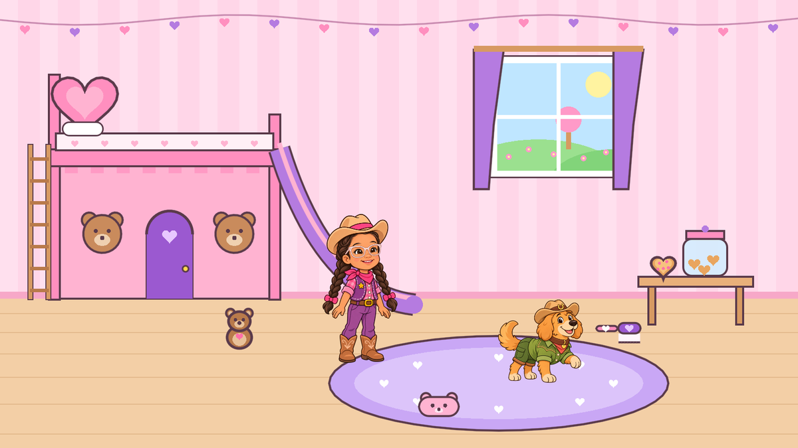
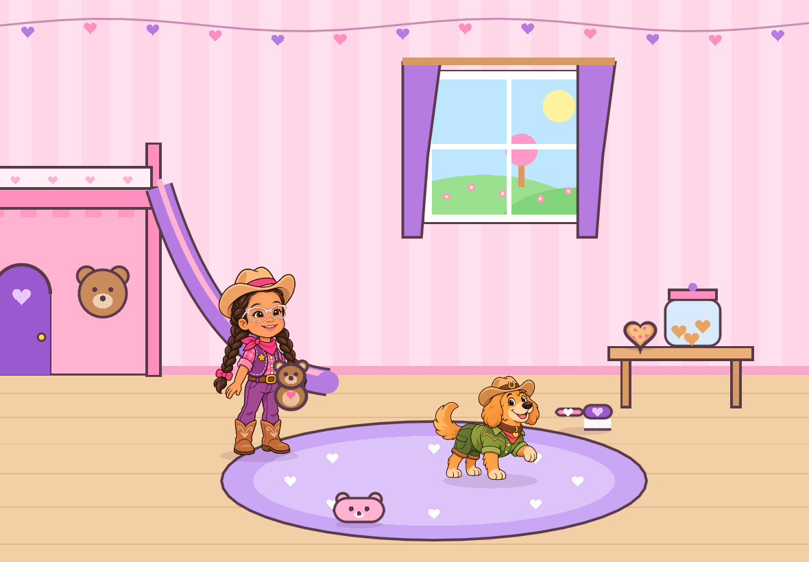
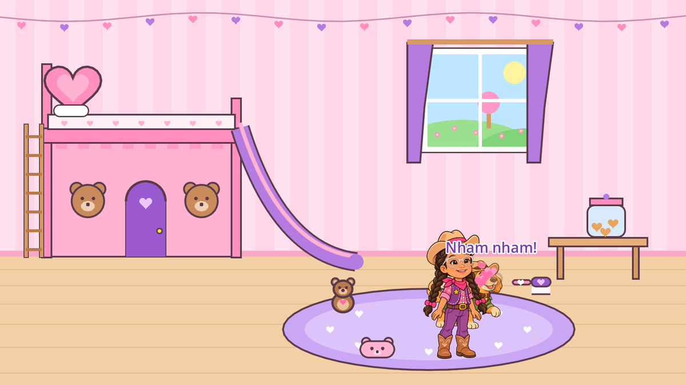
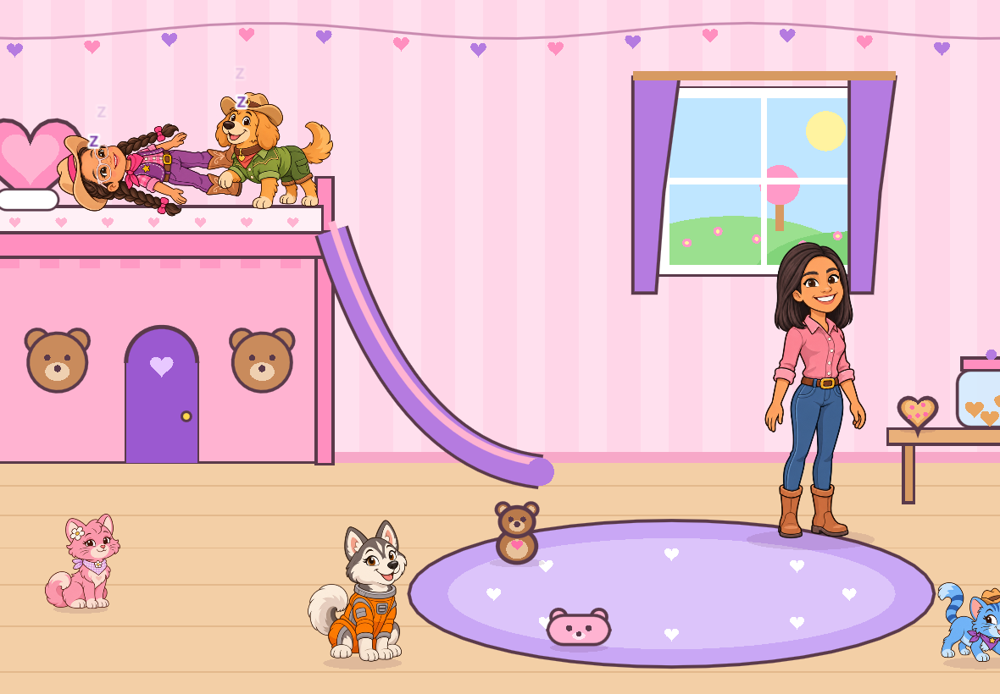
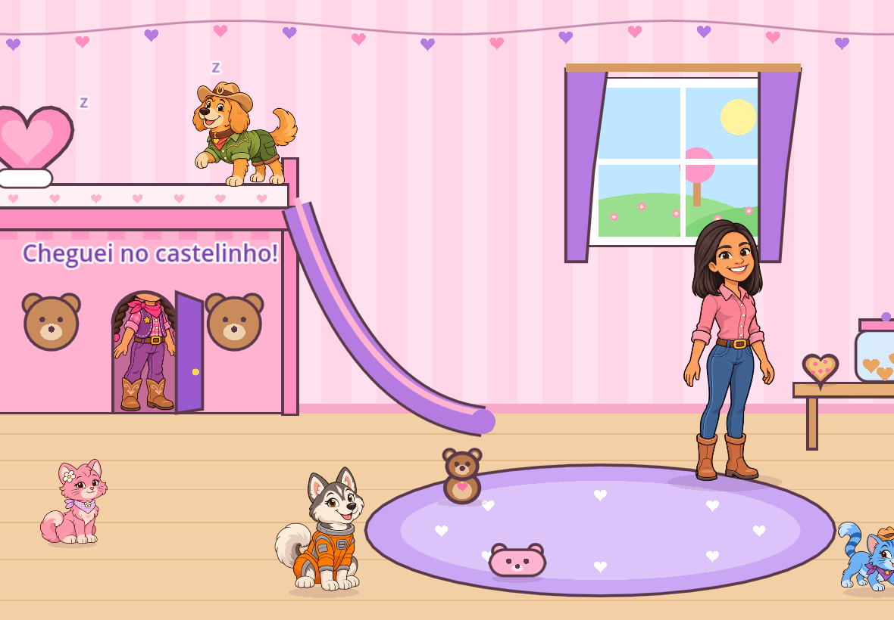
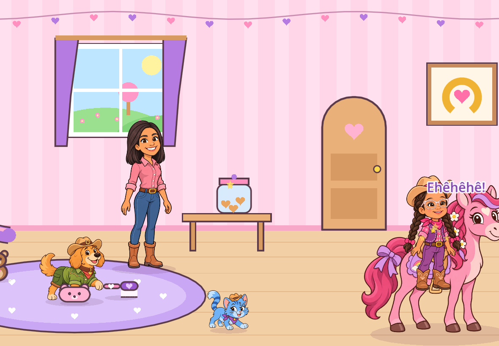
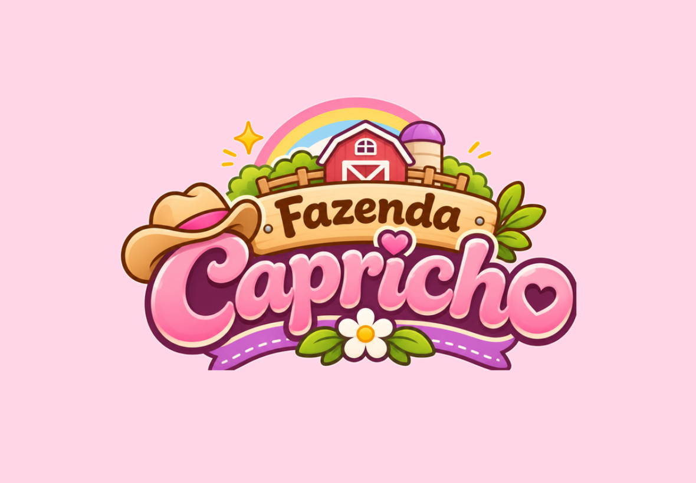
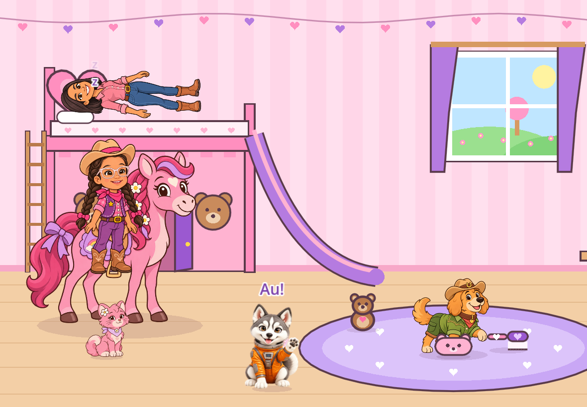
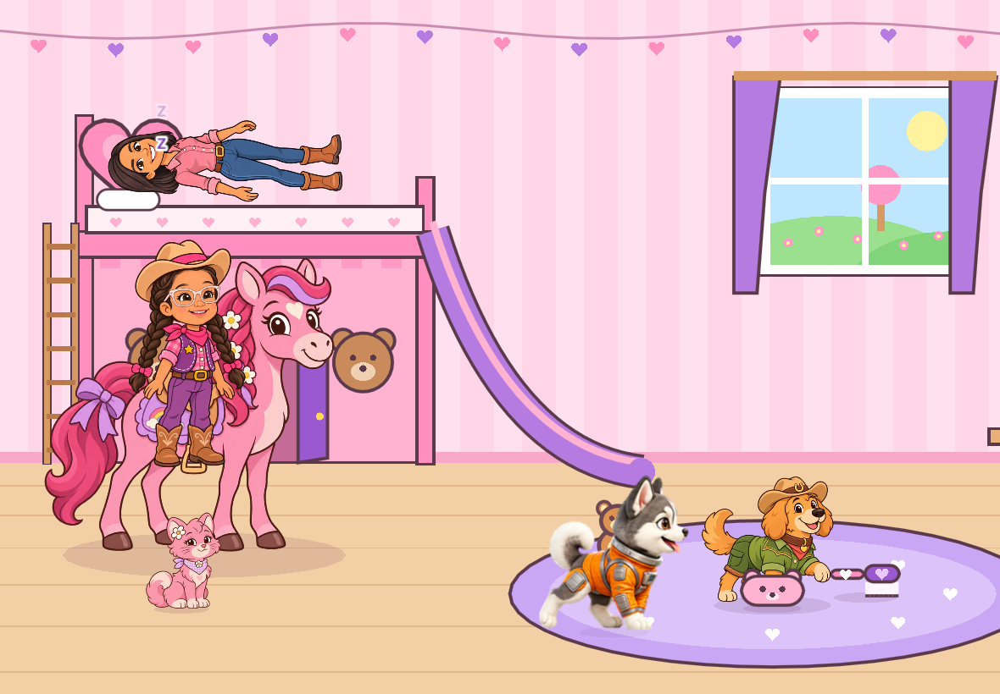

# Fazenda Capricho — Protótipo de interação P-0

Primeiro protótipo jogável, previsto na seção 8 do GDD (Revisão 4). Ele testa **apenas a base do
brinquedo**: arrastar, segurar, posicionar e combinar personagens e objetos no quarto da Catarina.

- **Plataforma-alvo: iPad, deitado (paisagem)**, no estilo Avatar World: o quarto é mais largo que a
  tela, a altura inteira cabe, e a criança rola para os lados com o dedo.
- **Motor:** Godot 4.4 (renderizador *Compatibility*), exportado para **web** (abre no Safari do iPad).
- **Personagens:** Catarina, Carol, Bob, Nina, Leo, Zoe e Lumi, com as imagens oficiais
  (`assets/personagens/`) na **tabela de escala** do GDD (Catarina = 300 px; Carol 1,35; Lumi 1,30;
  Nina 0,62; Bob 0,57; Zoe 0,42; Leo 0,35).
- **Catarina e Nina animadas (folhas de pet 3D):** a Catarina acena, corre, pula, faz "ops" e olha para o que é arrastado; a Nina corre ao ser arrastada, acena ao toque, pula ao ganhar
  biscoito, fica triste quando não cabe e olha para o objeto que a criança arrasta.
- **Marca:** abertura com a logo animada da entrega R01 (folha de 8 quadros) e ícone da ferradura
  na Tela de Início do iPad.
- **Cenário 3D:** o quarto e os objetos usam a arte 3D de `assets/cenario/` (originais em `arte/cenario/3d/`).
  Se uma imagem faltar, o jogo desenha a versão provisória no lugar.



| | |
|---|---|
|  |  |
|  |  |
|  |  |
|  |  |

## Abrir no iPad (versão web)

**Endereço:** <https://triade-prog.github.io/fazenda-capricho/>

1. Abra o endereço no **Safari** do iPad, com o iPad deitado.
2. Para ficar em tela cheia, como um app: botão **Compartilhar → Adicionar à Tela de Início**,
   e abra pelo ícone "Fazenda Capricho".

A versão web publicada fica na pasta `docs/` do repositório (GitHub Pages em
**Settings → Pages → Source: Deploy from a branch → `claude/brave-mendel-g0wd4g` / `docs`**).
Para atualizar depois de mudar o protótipo:

```bash
godot --headless --path prototipo --export-release "Web (iPad)" ../build/web/index.html
cp build/web/* docs/
```

O workflow `.github/workflows/web.yml` faz esse processo sozinho (testa, exporta e publica) quando o
GitHub Actions estiver liberado na conta; nesse caso, troque a origem do Pages para **GitHub Actions**.

## Abrir no computador (Godot)

1. Instale o [Godot 4.4](https://godotengine.org/download) (versão padrão, não a .NET).
2. No Godot, clique em **Importar** e escolha o arquivo `prototipo/project.godot`.
3. Pressione **F5** (ou o botão ▶) para rodar.

O mouse funciona como um dedo: clicar = tocar, clicar e arrastar = pegar. A janela abre no tamanho
de um iPad Air deitado (1180 x 820).

## O que dá para fazer

| Ação | Como |
|---|---|
| Pegar e mover qualquer coisa | Tocar e arrastar qualquer personagem ou objeto |
| Colocar um objeto na mão da Catarina ou da Carol | Soltar o objeto sobre ela (se a mão estiver ocupada, ela troca) |
| Pegar um objeto do chão | Soltar a Catarina ou a Carol sobre o objeto |
| Montar na Lumi | Soltar a Catarina ou a Carol sobre a sela; arrastando a Lumi, quem está montado vai junto |
| Dar biscoito aos bichos | Bob, Nina, Leo e Zoe comem o biscoito de coração (a Lumi não: petisco certo para cada bicho) |
| Escovar, brincar, cochilar | Escova, pelúcia ou almofada sobre um bicho (a Lumi gosta de ser escovada) |
| Dar biscoito ao Bob | Soltar o biscoito no Bob, **ou** levar a Catarina segurando o biscoito até ele, **ou** levar o Bob até o biscoito |
| Escovar o Bob | Escova sobre o Bob (ou pela mão da Catarina) |
| Brincar com o Bob | Pelúcia sobre o Bob |
| Bob tirar um cochilo | Almofada sobre o Bob |
| Deitar no beliche | Soltar alguém em cima da cama; cabem três (a Lumi é grande demais) |
| Subir a escada | Soltar a Catarina na escada: ela sobe e deita na cama |
| Descer o escorregador | Soltar a Catarina no alto do escorregador |
| Entrar no castelinho | Soltar a Catarina ou um bichinho na porta (a Carol e a Lumi não cabem) |
| Abrir/fechar a portinha roxa | Tocar na porta (com a porta fechada, quem está dentro fica escondido) |
| Ganhar biscoitos | Tocar no pote de biscoitos na mesinha (até 3 no quarto) |
| Reações rápidas | Tocar em qualquer um: Bob late ou espirra, Nina uiva, Leo pede "Dá, dá!", a Lumi relincha e gira |
| Rolar o quarto | Arrastar o dedo num espaço vazio (parede ou chão); solto, o quarto continua deslizando um pouco |
| Levar alguém para o outro lado do quarto | Arrastar o personagem até a borda da tela: o quarto rola junto |

Pensado para dedos no iPad:

- o personagem pego fica **um pouco acima do dedo**, para o dedo não cobrir o rosto;
- tocar tem uma folga de 14 px e **soltar em cima** de alguém tem folga de 40 px, para a criança
  não precisar acertar exatamente o corpo do Bob;
- enquanto algo está sendo arrastado, o lugar ou o personagem que vai receber o soltar **brilha**;
- só um dedo vale por vez: um segundo dedo na tela é ignorado, para não haver confusão;
- sombra nos pés de quem está em pé, para mostrar onde cada coisa está apoiada.

## Onde mexer

| Arquivo | Papel |
|---|---|
| `dados/interacoes.json` | **Tabela de brincadeiras.** Combinações objeto + alvo e reações ao toque. Nova brincadeira = nova linha, sem programar. |
| `scripts/main.gd` | Entrada por toque/mouse, regras de soltar, lugares interativos e reações. |
| `scripts/toy.gd` | Tudo que pode ser pego: pose, mão, cabeça, toque generoso, animação de respirar. |
| `scripts/slot.gd` | Lugares de encaixe (cama, castelinho, escorregador, escada). |
| `scripts/room.gd`, `castle_front.gd`, `item_art.gd` | Desenhos provisórios do quarto, do castelinho e dos objetos. |

Para adicionar um personagem (ex.: Nina, Carol), basta uma chamada a `_add_character()` em
`main.gd` com a imagem, a altura e a posição da mão/cabeça, e linhas novas em `interacoes.json`.

## Roteiro de teste (critério de aceite do P-0)

- [ ] Abrir a versão web num iPad de verdade (Safari), deitado, e adicionar à Tela de Início.
- [ ] Arrastar Catarina e Bob pelo quarto e rolar o quarto com o dedo.
- [ ] Colocar pelúcia, escova e biscoito na mão da Catarina; trocar o que ela segura.
- [ ] Deitar a Catarina no beliche (com e sem o Bob junto).
- [ ] Descer o escorregador e subir a escada.
- [ ] Abrir e fechar a portinha roxa com alguém dentro do castelinho.
- [ ] Dar petisco ao Bob dos três jeitos (direto, pela mão da Catarina, levando o Bob).
- [ ] Montar a Catarina na Lumi e passear com ela pelo quarto.
- [ ] Conferir se as proporções entre os personagens parecem certas no iPad.
- [ ] Observar uma criança brincando por 10 minutos, sem explicar nada: o que ela tenta fazer e não consegue?

## Teste automático

`testes/roteiro.tscn` simula toques **em coordenadas de tela**, como um dedo, e confere 33 itens:
segurar, trocar, dar biscoito, pote, rolar o quarto com gesto, rolar levando um personagem até a
borda, cama, castelinho, porta, escorregador, escada, cochilo, personagens novos no quarto, Nina
comendo, montar na Lumi, passear montada, Lumi girando, Lumi barrada no castelinho, Carol na cama e as ações da Nina (acenar, correr para os dois lados, parar,
olhar para o objeto arrastado, ficar triste com o castelinho cheio). Foi rodado nos tamanhos de tela
iPad 9,7"/mini (1024 x 768, 4:3) e iPad Air (1180 x 820), além da versão web num navegador emulando
um iPad Pro 11" com toque.

```bash
godot --headless --path prototipo res://testes/roteiro.tscn
```

Com `-- --capturas=/pasta` (e sem `--headless`) ele também salva as capturas de tela. Para testar
num tamanho de iPad: `--resolution 1180x820`.

## Personagens com folha de pet

`ferramentas/pet_para_jogo.py <pasta_do_pet> <nome>` prepara uma folha aprovada: separa uma imagem por
ação (o jogo carrega só as que usa), amplia 2x com filtro de nitidez (ou usa a versão `@2x` entregue pela
IA, que é ainda melhor) e grava o JSON com o colo (onde o objeto fica seguro) e o quadro de olhos fechados
para dormir. As imagens do jogo são comprimidas com perda leve (WebP 90%): o pacote web caiu de 21 MB para
6,5 MB. `testes/poses.tscn` captura a Catarina em várias situações para conferência visual.

## Limitações conhecidas (esperadas nesta fase)

- Personagens são imagens únicas: "abanar o rabo", "piscar" e "andar" são simulados com o corpo
  inteiro (balançar, pular, amassar). As animações reais dependem da arte em partes separadas (GDD, seção 7).
- Montada na Lumi, a Catarina aparece em pé na sela: a pose sentada depende da folha `catarina_sentada`.
- Só a Nina tem animações desenhadas (folha de pet). Os outros personagens ainda são imagens únicas
  com respiração feita pelo jogo; ver `docs/padrao_geracao_personagens.md`.
- Sem sons, sem salvamento e sem troca de ambiente.
- A versão web foi testada no Chromium emulando um iPad; ainda falta testar no Safari de um iPad de verdade.
- Os textos que aparecem nas falas usam a fonte padrão do Godot; a fonte do jogo ainda será escolhida.
